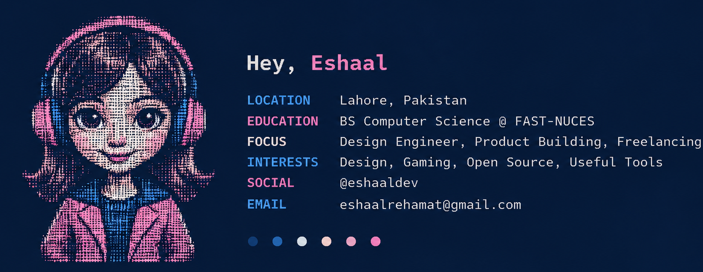

<!-- eshaaldev / GitHub Profile -->

  

 

### 01 | Toolkit

<table>
  <tr>
    <td width="50%" valign="top">
      <strong>Web Development</strong>
        
      
    </td>
    <td width="50%" valign="top">
      <strong>Design</strong>
        
  
  
  

  </td>
  </tr>
  <tr>
    <td width="50%" valign="top">
      <strong>Computer Science</strong>
        
      
    </td>
    <td width="50%" valign="top">
      <strong>Tools & Platforms</strong>
        
      
    </td>
  </tr>
</table>

 

### 02 | Selected Work

A few things I've designed and built.

| Project | Description | Stack |
| :--- | :--- | :--- |
| **[EshaalTab](https://github.com/EshaalB)** | A customizable new-tab experience for a more organized browser. | JavaScript, CSS |
| **[StudReads](https://github.com/EshaalB)** | Turn university timetable files into organized schedules directly in your browser. | React, PDF.js, SheetJS |

Explore more projects through my pinned repositories below.

 

### 03 | Elsewhere

[Portfolio](https://github.com/EshaalB) &nbsp;·&nbsp; [Instagram](https://instagram.com/eshaaldev) &nbsp;·&nbsp; [LinkedIn](https://www.linkedin.com/) &nbsp;·&nbsp; [Email](mailto:eshaalrehamat@gmail.com)

 

  <picture>
    <source
      media="(prefers-color-scheme: dark)"
      srcset="https://raw.githubusercontent.com/EshaalB/EshaalB/output/pacman-contribution-graph-dark.svg"
    />
    <source
      media="(prefers-color-scheme: light)"
      srcset="https://raw.githubusercontent.com/EshaalB/EshaalB/output/pacman-contribution-graph.svg"
    />
    
  </picture>

